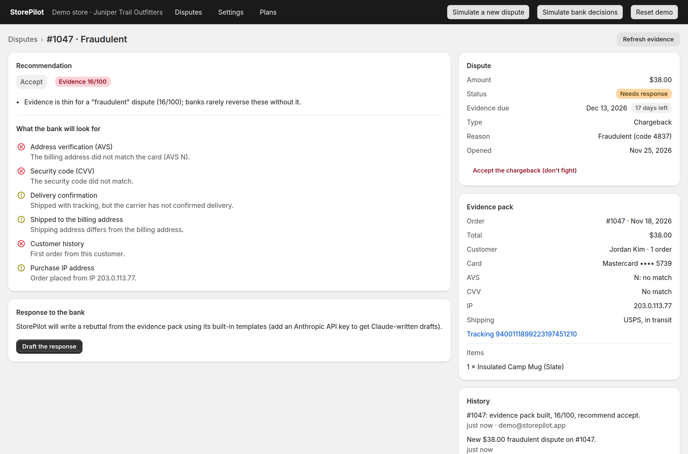
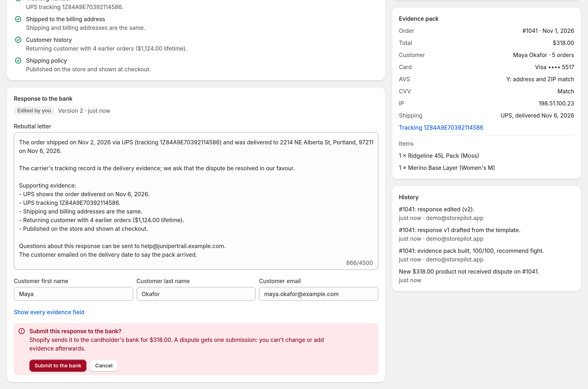
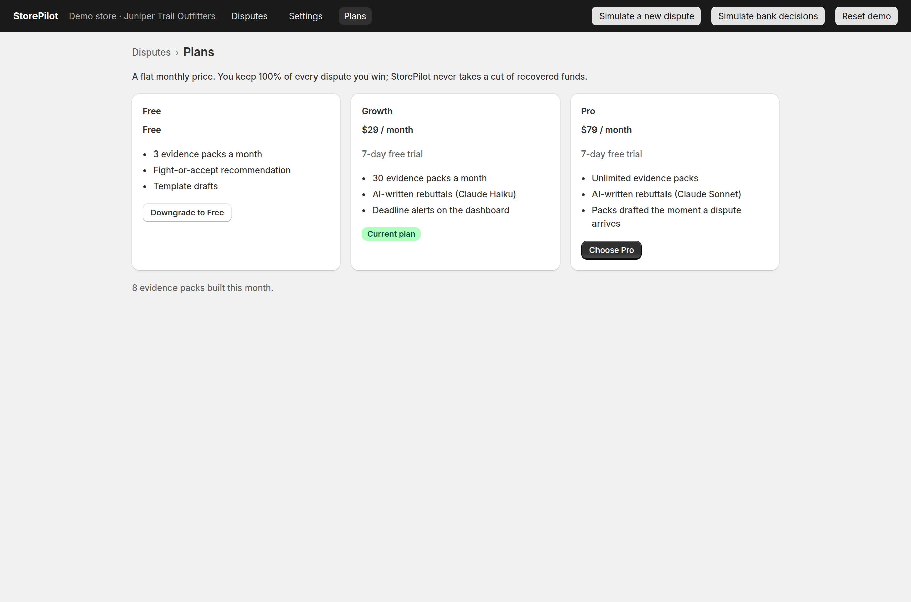

# StorePilot

Chargeback defense for Shopify Payments merchants. When a customer disputes a
charge, StorePilot pulls everything Shopify knows about the order into an
evidence pack, tells you whether the dispute is worth fighting, and drafts the
response. You read it, change what you want, and submit it from inside your
Shopify admin. Nothing goes to the bank until you press the button.


## Why this exists

Small stores lose most chargebacks by not answering them. The deadline is a
week or two, the response form asks for things scattered across five admin
pages (tracking, AVS and CVV results, the customer's history, your refund
policy), and writing a persuasive letter for a bank analyst is nobody's job.
So the dispute expires, the money is gone, and Shopify adds a $15 fee.

The services that do this for you take 20-25% of whatever they recover.
StorePilot is a flat monthly price and you keep everything you win.

## What it does

1. **Picks up every dispute.** A sync on install, then `disputes/create` and
   `disputes/update` webhooks. Deadlines are front and center in the inbox.
2. **Builds the evidence pack.** The order, payment checks (AVS, CVV, IP), fulfillment
   and tracking, refunds, the customer's order history and your published policies,
   all read through the GraphQL Admin API.
3. **Scores it for the reason code.** "Product not received" lives or dies on delivery
   proof; "fraudulent" on AVS/CVV and customer history; "credit not processed" on the
   refund record. Each reason has its own checklist, and the score decides the
   recommendation: fight, accept, or take a closer look. Small, weak disputes get an
   honest "not worth it".
4. **Drafts the response.** A rebuttal letter plus the specific evidence fields the
   bank expects. Claude writes it on paid plans (structured output, facts only, no
   invented tracking events); a deterministic template writer covers the same fields
   on the free plan or when no API key is set.
5. **Waits for you.** Edit anything, save the draft to Shopify, then submit. Submitting
   is one-shot and the UI says so before it happens.
6. **Tracks the outcome.** Won and lost disputes come back by webhook; the dashboard
   shows money recovered and your win rate.


| | |
|---|---|
|  |  |

## Try it without a store

Every deploy has a public demo at `/demo`: a seeded outdoor-gear store with ten
disputes, running the real code paths against an in-memory Shopify Admin API.
You can draft, edit and submit responses, make a new dispute arrive, and have
the bank decide.

```bash
pnpm install
pnpm prisma migrate deploy
pnpm dev:demo          # http://localhost:5173/demo
```

## Install it on your store

[docs/INSTALL.md](docs/INSTALL.md) walks through it: create the app in Shopify's
Dev Dashboard, deploy to Render with one click (paste the client id and secret),
release a version that points at your server, and click Install. No CLI needed.

## Plans

| Plan | Price | |
|---|---|---|
| Free | $0 | 3 evidence packs a month, template drafts |
| Growth | $29/mo | 30 packs a month, Claude-written drafts |
| Pro | $79/mo | Unlimited packs, drafts ready the moment a dispute arrives |

Charged through the Shopify Billing API with a 7-day trial. No cut of recovered funds.



## How it's built

- Shopify's React Router app template: embedded in the admin with App Bridge, UI in
  Polaris web components, token-exchange auth with expiring offline tokens, Prisma
  session storage on SQLite.
- GraphQL Admin API only. Every query and mutation lives in
  [`app/lib/shopify/queries.ts`](app/lib/shopify/queries.ts) so the scope list can be
  checked against one file. Evidence goes back through `disputeEvidenceUpdate`.
- Six scopes: `read_orders`, `read_customers`, `read_legal_policies`,
  `read_shopify_payments_disputes`, `read_shopify_payments_dispute_evidences`,
  `write_shopify_payments_dispute_evidences`.
- Webhooks for disputes, uninstall, subscription changes, and the three mandatory
  privacy topics. A customer redaction scrubs their details from evidence packs and
  drafts; `shop/redact` deletes everything for the shop.
- Scoring ([`evidence.ts`](app/lib/disputes/evidence.ts)) is plain deterministic code,
  so a merchant (or a test) can see exactly why a dispute got its recommendation. The
  model only writes words.
- Claude drafting ([`ai.server.ts`](app/lib/disputes/draft/ai.server.ts)): Haiku on
  Growth, Sonnet on Pro, a cached system prompt, a Zod schema for the output, and a
  fallback to the template writer on any failure. Customer names, email and the
  shipping address are copied from Shopify's record, never from the model.
- Docker image plus Render and Fly configs. SQLite on a mounted disk; one instance.

```
app/
  lib/shopify/        Admin API queries, typed calls, response normalizers
  lib/disputes/       sync, evidence packs, scoring, drafting, read models
  lib/demo/           seeded store and the in-memory Admin API mock
  lib/gdpr.server.ts  privacy webhooks
  components/         inbox, dispute detail, settings, plans (shared by /app and /demo)
  routes/             app.*, webhooks.*, demo.*, privacy, healthz
test/
  unit/               scoring, normalizing, drafting
  integration/        the dispute loop on SQLite with the mock API
  e2e/                install through token exchange, signed webhooks, billing approval,
                      submit, outcome, uninstall, against a fake Shopify behind fetch
```

## Tests

```bash
pnpm typecheck
pnpm test               # unit
pnpm test:integration   # services against SQLite + the mock Admin API
pnpm test:e2e           # the real Shopify library against a fake Shopify
pnpm walkthrough        # headless Chrome through the demo (needs a running server)
```

## History

StorePilot started in early 2026 as a general "LLM workflow engine for Shopify",
with a demo storefront and a chat agent. That turned out to be a platform looking
for a problem; [docs/DIRECTION.md](docs/DIRECTION.md) explains why it became
one job done properly instead. The old code is in the git history.

## License

MIT
