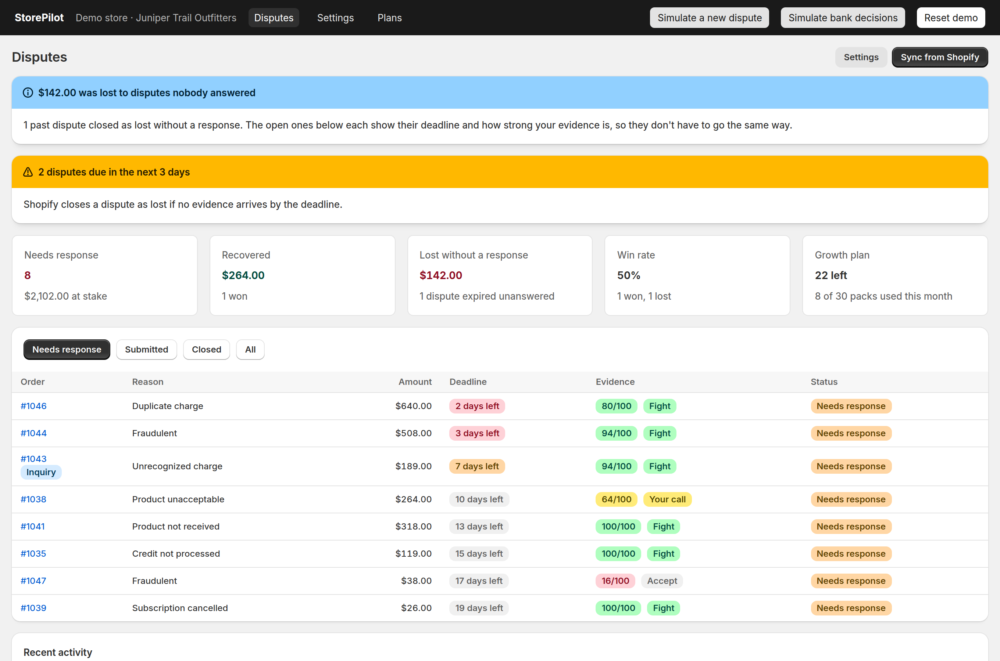
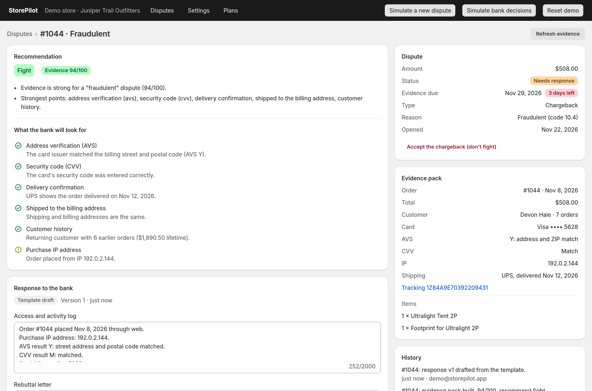

# StorePilot

A Shopify app for answering chargebacks on Shopify Payments.

When a dispute comes in, StorePilot collects the order details Shopify already has
(payment checks, tracking, refunds, the customer's past orders, your policies),
suggests whether to fight it, and drafts a response. You edit the draft and submit
it from the Shopify admin. Nothing is sent until you submit.



Most small stores lose chargebacks because they never respond. The evidence is spread
over several admin pages and the deadline is short. Services that handle it for you
usually take 20-25% of what they recover. StorePilot is a flat monthly price instead.

## How it works

- Disputes are synced on install and kept current with the `disputes/create` and
  `disputes/update` webhooks. The inbox is sorted by deadline.
- For each dispute it builds an evidence pack from the GraphQL Admin API: the order,
  AVS/CVV/IP results, fulfillments and tracking, refunds, order history and store policies.
- Each reason code has its own checklist. A "not received" dispute needs proof of
  delivery, a "fraudulent" one leans on AVS/CVV and history, "credit not processed"
  on the refund record. The score gives a recommendation: fight, accept, or review.
  Small disputes with weak evidence get "accept".
- The draft is a rebuttal letter plus the evidence fields the bank asks for. On paid
  plans Claude writes it; otherwise a template fills in the same fields.
- You can edit everything and save it back to Shopify. Submitting can only happen once,
  so the app asks you to confirm first.
- Outcomes come back by webhook, and the dashboard shows win rate, money recovered,
  and money lost to disputes nobody answered.
- On paid plans, an email goes out when a dispute arrives and again 7, 3 and 1 day
  before its deadline. Every plan gets a short monthly summary email.
- New installs get a short setup checklist on the home page (import, support email,
  policies, plan).



| | |
|---|---|
|  |  |

## Demo

There's a demo at `/demo` with a seeded store and ten disputes. It runs the same code
against an in-memory version of the Admin API, so you can draft, edit, submit, trigger
a new dispute and have the bank decide it.

```bash
pnpm install
pnpm prisma migrate deploy
pnpm dev:demo          # http://localhost:5173/demo
```

## Installing

See [docs/INSTALL.md](docs/INSTALL.md). Short version: create the app in Shopify's
Dev Dashboard, deploy to Render with the button in that doc, release a version pointing
at your server, then install it on your store. You don't need the Shopify CLI.

## Plans

| Plan | Price | |
|---|---|---|
| Free | $0 | 3 evidence packs a month, template drafts |
| Growth | $29/mo | 30 packs a month, Claude drafts, deadline alert emails |
| Pro | $79/mo | Unlimited, drafts written as soon as a dispute arrives, deadline alert emails |

Billed through Shopify with a 7-day trial.

## Stack

Built on Shopify's React Router app template: embedded with App Bridge, Polaris web
components, token-exchange auth, Prisma with SQLite.

- All Admin API queries and mutations are in
  [`app/lib/shopify/queries.ts`](app/lib/shopify/queries.ts). Evidence is saved with
  `disputeEvidenceUpdate`.
- Scopes: `read_orders`, `read_customers`, `read_legal_policies`,
  `read_shopify_payments_disputes`, `read_shopify_payments_dispute_evidences`,
  `write_shopify_payments_dispute_evidences`.
- Webhooks: disputes, app uninstall, subscription updates, and Shopify's three
  privacy webhooks. `customers/redact` scrubs that customer from packs and drafts;
  `shop/redact` deletes the shop's data.
- Scoring ([`evidence.ts`](app/lib/disputes/evidence.ts)) is ordinary code, so the
  reason for a recommendation is always visible. The model only writes the text.
- Drafting ([`ai.server.ts`](app/lib/disputes/draft/ai.server.ts)) uses Haiku on Growth
  and Sonnet on Pro, validates the output with Zod, and falls back to the template if
  anything fails. Names, emails and addresses come from Shopify, not the model.
- Deploys with Docker, Render or Fly. One instance, SQLite on a mounted disk.

```
app/
  lib/shopify/        Admin API queries and response normalizers
  lib/disputes/       sync, evidence packs, scoring, drafting
  lib/demo/           demo store and mock Admin API
  lib/gdpr.server.ts  privacy webhooks
  components/         inbox, dispute detail, settings, plans
  routes/             app.*, webhooks.*, demo.*, privacy, healthz
test/
  unit/  integration/  e2e/
```

## Tests

```bash
pnpm typecheck
pnpm test               # unit
pnpm test:integration   # SQLite + mock Admin API
pnpm test:e2e           # real Shopify library against a fake Shopify
pnpm walkthrough        # headless Chrome through the demo (server must be running)
```

## License

MIT
